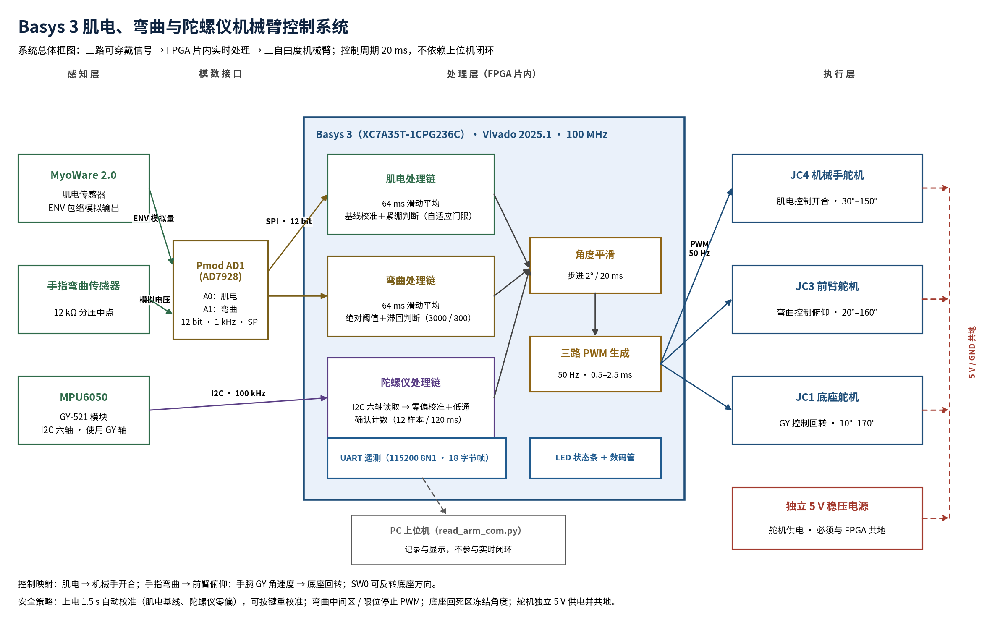

# 基于 Basys 3 的肌电、弯曲与陀螺仪机械臂控制系统设计报告

## 作品与队伍信息

| 项目 | 内容 |
| --- | --- |
| 正式作品名称 | 基于 Basys 3 的肌电、弯曲与陀螺仪机械臂控制系统 |
| 报名题目 | 基于FPGA的肌电手势机械手 |
| 参赛厂商 | AMD |
| 平台范围 | AMD 7 Series FPGA、Zynq-7000 SoC、UltraScale 或 UltraScale+ 系列器件 |
| 开发方向 | AMD-自主选题（初级） |
| 参赛组别 | 本科 |
| 团队编号 | 55240 |
| 队伍名称 | 南北红豆 |
| 团队成员 | 杜涵宇、郑钧仁 |
| 队长联系方式 | 473929401@qq.com |
| 项目仓库 | [GitHub 仓库](https://github.com/jrrrr26/FPGA-basys3-robotic_arm) |
| 演示视频 | [Bilibili 演示](https://www.bilibili.com/video/BV1iu4K6yEWw) |
| 完成日期 | 2026-11-03 |

## 摘要

本项目面向人机交互和轻量机械臂控制场景，设计了一套基于 Digilent Basys 3（XC7A35T）的三传感器实时控制系统。系统使用 MyoWare 2.0 表面肌电包络控制机械手开合，使用弯曲传感器控制前臂位置，使用 MPU6050 陀螺仪 GY 轴控制底座转动。ADC 采样、滑动平均、肌电基线校准、弯曲阈值控制、MPU6050 I2C 读取、陀螺仪零偏校准、舵机 PWM 和 UART 遥测均在 FPGA 片内完成，不依赖上位机参与实时闭环。

最终设计已通过 Vivado 2025.1 综合、实现、时序和 DRC 检查，WNS 为 +1.048 ns，WHS 为 +0.065 ns，使用 Slice LUT 1448、Slice Register 971、DSP 6、Block RAM 0。三组 Testbench 分别验证最终系统集成、弯曲前臂控制和陀螺仪底座控制，全部通过。

## 1. 选题背景与目标

### 1.1 应用背景

肌电、关节弯曲和手腕转动分别反映不同的操作意图。将多种可穿戴信号映射到机械臂的不同关节，可以在康复辅助、人机协作和轻量仿生设备中形成直观控制接口。纯软件采集链路容易受到操作系统调度、USB 传输和上位机负载影响，因此本项目使用 FPGA 承担实时采样与控制。

### 1.2 设计目标

- 以 Basys 3 为唯一实时控制器。
- 完成肌电、弯曲和陀螺仪三类传感器采集。
- 分别控制机械手、前臂和底座三个执行器。
- 对肌电和陀螺仪执行自动校准。
- 控制过程中避免舵机在无效区或机械限位持续堵转。
- 提供 UART 遥测，便于记录和验证。
- 保证工程可由他人从源码和脚本复现。

### 1.3 报名题目与实际方案的关系

报名题目为“基于FPGA的肌电手势机械手”。开发过程中，为保证系统在现有机械结构和传感器条件下完成可验证闭环，最终方案扩展为肌电、弯曲和陀螺仪三传感器共同控制机械臂。本报告后续以扩展后的三传感器方案为说明对象。

### 1.4 相关工作与技术路线

常见的肌电机械臂方案包括：

- 电脑采集卡方案：采集和算法开发方便，但体积较大，控制延迟受操作系统和 USB 链路影响。
- 单片机方案：成本和功耗较低，适合单路或低实时性控制，但多路采样、滤波和 PWM 并行处理能力有限。
- FPGA 方案：适合多通道同步采样、确定性时序和并行数据处理，但需要自行完成接口、状态机和硬件调试。

本项目选择 FPGA 片内闭环，利用并行采样、滑动窗口、I2C 读取和多路 PWM 的确定性时序优势，同时保留 UART 作为调试和测试接口。

### 1.5 创新点

- 将肌电、弯曲和陀螺仪三类信号分别映射到机械手、前臂和底座，三路控制均在 FPGA 内完成，不依赖上位机闭环。
- 陀螺仪控制采用连续样本方向确认和死区立即冻结，减少平移干扰和停止后的额外转动。
- 弯曲控制采用绝对阈值、滞回、点动与限位停 PWM 组合，兼顾中间区稳定和机械限位保护。
- 将干净构建检查与 UART 帧检查整理为可复用脚本，便于其他 FPGA 项目迁移。

## 2. 需求分析与系统指标

| 类别 | 指标 |
| --- | --- |
| 主控 | Basys 3，XC7A35T-1CPG236C |
| 系统时钟 | 100 MHz |
| ADC | Pmod AD1，双通道 12 bit，每通道 1 kHz |
| 肌电处理 | 64 ms 滑动平均，自适应基线 |
| 弯曲控制 | 绝对阈值与滞回，20°～160° |
| 陀螺仪 | MPU6050，I2C 100 kHz，使用 GY 轴 |
| 陀螺仪确认 | 12 个连续样本，约 120 ms |
| 舵机 | 3 路，50 Hz，0.5～2.5 ms |
| 串口 | 115200 8N1，18 字节带异或校验 |
| 时序 | 所有用户约束满足，WNS > 0 |
| 资源 | 1448 LUT、971 FF、6 DSP、0 BRAM |

## 3. 系统总体方案

### 3.1 传感器到执行器映射

| 传感器 | 数据通路 | 执行器 |
| --- | --- | --- |
| MyoWare 2.0 ENV | Pmod AD1 A0 -> 滑动平均 -> 肌电基线 -> 紧绷判断 | JC4 机械手 |
| 弯曲传感器 | Pmod AD1 A1 -> 滑动平均 -> 阈值/滞回控制 | JC3 前臂 |
| MPU6050 GY | I2C -> 零偏校准 -> 低通 -> 方向确认 | JC1 底座 |

### 3.2 软硬件划分

- FPGA 负责所有实时采样、判断、状态机和 PWM 输出。
- Python 脚本只负责串口读取、状态显示和 CSV 记录，不参与实时闭环。
- 舵机使用独立 5 V 电源，FPGA 只提供 PWM 信号。

### 3.3 功能框图

系统功能框图见图 3-1，展示三类传感器、FPGA 内部处理模块、三路舵机、状态显示和 UART 遥测之间的连接关系。



<p align="center">图 3-1 系统功能框图</p>

## 4. 硬件设计

### 4.1 主要器件

| 器件 | 用途 |
| --- | --- |
| Digilent Basys 3 | FPGA 主控和板上显示 |
| Pmod AD1 | MyoWare 与弯曲传感器双通道采样 |
| MyoWare 2.0 | 表面肌电模拟前端 |
| 弯曲传感器 + 12 kΩ 分压 | 前臂动作输入 |
| GY-521 / MPU6050 | 三轴加速度与三轴角速度 |
| 3 个 180° 舵机 | 底座、前臂、机械手 |
| 独立稳压 5 V 电源 | 舵机供电 |

### 4.2 关键连线

| 功能 | Basys 3 接口 |
| --- | --- |
| Pmod AD1 | JA1～JA6 |
| MyoWare ENV | AD1 A0 |
| 弯曲分压中点 | AD1 A1 |
| MPU6050 VCC / GND | JB6 3.3 V / JB5 GND |
| MPU6050 SDA / SCL | JB1 A14 / JB2 A16 |
| MPU6050 AD0 | GND，地址 0x68 |
| JC1 底座 | K17 |
| JC3 前臂 | N17 |
| JC4 机械手 | P18 |
| JC2 | 不使用 |

完整接线要求见 [../board/wiring.md](../board/wiring.md)。

## 5. FPGA 逻辑设计

### 5.1 采样与预处理

- `sample_tick_gen` 生成 1 kHz ADC 采样节拍和 50 Hz 舵机更新节拍。
- `spi_adc` 读取 Pmod AD1 两路 12 位数据。
- 两个 `window_average_unsigned` 分别处理肌电和弯曲通道，窗口长度 64，步长 8。

### 5.2 肌电控制

- `emg_state_classifier` 在约 1.5 秒校准窗口内估计放松基线。
- 平滑活动值超过自适应门限后判定紧绷。
- `angle_slew` 使 JC4 从 30° 平滑移动到 150°，避免瞬间跳变。
- 肌电恢复放松后，机械手目标角回到 30°。

### 5.3 弯曲前臂控制

- `flex_angle_mapper` 使用绝对阈值，不依赖每次上电基线。
- 高值进入门限 3000，释放门限 2500。
- 低值进入门限 800，释放门限 1200。
- 每 20 ms 改变 2°，限位为 20° 和 160°。
- 回到中间区或达到限位后关闭 PWM，保留最后角度。

### 5.4 陀螺仪底座控制

- `mpu6050_six_axis_reader` 每次读取 0x3B～0x48 共 14 字节。
- 最终选择 GY 轴作为底座控制输入。
- `gyro_bias_calibrator` 计算静止零偏并执行 1/8 低通。
- `gyro_base_controller` 使用 2600 死区、5000 中速门限、10000 快速门限。
- 方向必须连续保持 12 个样本才确认动作。
- 回到死区后立即冻结目标角度。
- `SW0` 用于反转方向，适配不同佩戴方向。
- 底座目标角限制为 10°～170°。

### 5.5 PWM 与遥测

- `servo_pwm_pulse` 产生三路 50 Hz 舵机 PWM。
- `uart_single_frame_tx` 产生 18 字节遥测帧。
- LED 和七段数码管用于无上位机状态观察。

### 5.6 接口设计

| 接口 | 信号 | 方向 | 速率/时序 |
| --- | --- | --- | --- |
| Pmod AD1 SPI | CS、SCLK、D0、D1 | FPGA 输出/输入 | 1 MHz SCLK，1 kHz 采样 |
| MPU6050 I2C | SDA、SCL | 双向/输出 | 100 kHz |
| 舵机 PWM | JC1、JC3、JC4 | 输出 | 50 Hz，0.5～2.5 ms |
| UART | TXD | 输出 | 115200 8N1 |
| LED/数码管 | LED0～15、seg、an、dp | 输出 | 板上状态显示 |
| 按键/开关 | btnC、btnU、SW0 | 输入 | 复位、重校准、方向切换 |

## 6. 通信协议

串口参数为 `115200 8N1`，帧格式：

```text
AA 55
seq_hi seq_lo
raw_hi raw_lo
mav_hi mav_lo
baseline_hi baseline_lo
threshold_hi threshold_lo
flex_hi flex_lo
gyro_hi gyro_lo
status
xor_checksum
```

状态位：

| 位 | 含义 |
| --- | --- |
| bit0 | 肌电紧绷 |
| bit1 | 肌电校准完成 |
| bit2 | 肌电正在校准 |
| bit3 | 机械手控制激活 |
| bit4 | 弯曲控制已获得有效输入 |
| bit5 | 陀螺仪校准完成 |
| bit6 | I2C ACK 异常 |
| bit7 | 底座控制激活 |

## 7. 软件工具

`board/software/read_arm_com.py` 完成：

- 自动寻找 FTDI 串口，或使用 `--port` 指定 COM 口。
- 搜索 `AA 55` 帧头。
- 检查 18 字节长度和异或校验。
- 解析 16 位有符号陀螺仪值。
- 输出可读状态并将有效帧保存为 CSV。

## 8. 仿真与验证

### 8.1 最终系统 Testbench

```text
PASS EMG and flex calibration completed
PASS gripper closed: angle=58 pulse=1144 us
PASS flex JC3 angle=160 pulse=0 us
TB_BASYS3_ARM_FINAL_TOP: PASS
```

### 8.2 弯曲方向控制 Testbench

```text
PASS startup stopped at angle=90
PASS high jog angle=100
PASS deadband holds angle=100 with PWM stopped
PASS low jog angle=90
PASS upper limit angle=160 with PWM stopped
PASS lower limit angle=20 with PWM stopped
TB_FLEX_DIRECTION_CONTROLLER: PASS
```

### 8.3 陀螺仪底座控制 Testbench

```text
PASS confirmation and positive motion target=91
PASS sustained motion target=96
PASS deadband freezes target=96
PASS negative motion target=95
TB_GYRO_BASE_CONTROLLER: PASS
```

### 8.4 板级验证

| 功能 | 结果 |
| --- | --- |
| 上电复位与心跳 | 通过 |
| 肌电自动校准 | 通过 |
| 肌电控制机械手开合 | 通过 |
| 弯曲传感器控制前臂 | 通过 |
| MPU6050 GY 控制底座 | 通过 |
| SW0 方向切换 | 通过 |
| 按键重新校准 | 通过 |
| UART 遥测 | 通过 |
| 独立 5 V 舵机供电与共地 | 通过 |

测试步骤和记录字段见 [board-test-method.md](board-test-method.md)。

### 8.5 量化测试结果

| 测试项 | 结果 |
| --- | --- |
| 肌电机械手重复成功 | 10 / 10 |
| 弯曲前臂高方向成功 | 10 / 10 |
| 弯曲前臂低方向成功 | 10 / 10 |
| 陀螺仪底座左转成功 | 7 / 10 |
| 陀螺仪底座右转成功 | 8 / 10 |
| 陀螺仪停止冻结成功 | 8 / 10 |
| 串口统计（实际 60.13 s） | 有效帧 7497，校验错误 0，序号跳变 0 |
| 连续运行 | 30 min，异常复位 2 次，舵机异常动作 15 次，I2C 偶发错误；未通过 |

连续运行未达到“无异常复位、无异常舵机动作”的预定判据。异常仍需结合电源波动、接线可靠性、机械限位和控制状态进一步定位。

## 9. 综合与实现结果

| 指标 | 结果 |
| --- | --- |
| Vivado | 2025.1 |
| 器件 | xc7a35tcpg236-1 |
| 综合 | 0 error |
| 实现 | 0 error |
| WNS | +1.048 ns |
| WHS | +0.065 ns |
| 失败端点 | 0 |
| Slice LUT | 1448 / 20800（6.96%） |
| Slice Register | 971 / 41600（2.33%） |
| DSP | 6 / 90（6.67%） |
| Block RAM | 0 / 50 |
| DRC | 0 error，18 条 DSP 流水线性能建议 |
| bitstream 大小 | 2,192,144 字节 |
| bitstream SHA256 | D489C8CF15FD0207EB3866C9796E268C7C53CCDDDA10FFFEC5AE7690FEAC56AA |

官方推荐 Vivado 2026.1 或 2025.2。本项目使用 Vivado 2025.1，并通过自包含脚本从干净仓库重新创建工程、运行仿真和完成构建，以满足可复现要求。

### 9.1 Vivado 版本说明与可复现性

赛事指南推荐使用 Vivado / Vitis 2026.1（推荐）或 2025.2。本项目实际使用 Vivado 2025.1，原因如下：

- 项目从开发初期即在 Vivado 2025.1 下建立并完成综合、实现和上板验证。
- 现有 Basys 3 工具链、器件库和脚本均在 2025.1 下验证通过。
- 为避免在比赛提交前更换工具版本引入新的工程兼容风险，本次继续使用已验证版本。

为证明该版本选择不影响工程复现，项目组已在整理后的仓库中执行以下干净构建：

```powershell
$env:PROJECT_ROOT=(Resolve-Path ".").Path
python skill/vivado-clean-build/check_repo.py .
vivado -mode batch -source build/create_project.tcl
vivado -mode batch -source sim/run_simulation.tcl
vivado -mode batch -source build/build_bitstream.tcl
```

复现结果：

- 三组 Testbench 全部 PASS。
- 综合和实现均为 0 error。
- 时序约束全部满足，WNS 为 `+1.048 ns`，WHS 为 `+0.065 ns`。
- 资源占用与提交报告一致：LUT 1448、FF 971、DSP 6、BRAM 0。
- DRC 为 0 error。
- bitstream 成功生成。

工程使用标准 Tcl 脚本创建工程，不依赖图形界面手工操作。若后续迁移至 Vivado 2025.2 或 2026.1，应按相同步骤重新创建工程、运行全部 Testbench，并重新核对时序和资源结果。

## 10. 优化过程

| 优化项 | 优化前 | 优化后 | 结果 |
| --- | --- | --- | --- |
| 底座控制轴 | 最初使用 GZ | 读取六轴数据并选择 GY | 预期手腕转动响应更明确，平移干扰更低 |
| 方向确认 | 计数到上限后只触发一次 | 达到确认数后持续响应 | 修复底座只动一下或不动 |
| 死区行为 | 停止后仍可能追赶旧目标 | 回到死区立即冻结目标 | 避免停止过程产生额外角度 |
| 弯曲控制 | 连续比例映射 | 绝对阈值、滞回和点动 | 中间区稳定，方向明确 |
| 限位保护 | 到限位仍可能输出 PWM | 到限位立即关闭 PWM | 降低堵转发热风险 |
| 佩戴方向 | 固定方向 | SW0 方向取反 | 适配不同安装方向 |
| 遥测 | 信息不足 | 18 字节完整状态帧 | 便于 CSV 记录和问题定位 |

优化前后的主要资源与时序结果如下：

| 指标 | 单通道基线 | 最终三传感器系统 |
| --- | ---: | ---: |
| Slice LUT | 1177 | 1448 |
| Slice Register | 943 | 971 |
| DSP | 1 | 6 |
| WNS | +2.279 ns | +1.048 ns |
| 传感器/执行器 | 1 / 1 | 3 / 3 |

历史单通道基线使用 LUT 1177、FF 943、DSP 1，WNS 为 +2.279 ns。最终三传感器、三舵机系统使用 LUT 1448、FF 971、DSP 6，WNS 为 +1.048 ns。资源增加对应新增的 MPU6050 I2C、三路 PWM 和控制逻辑，时序仍满足约束。

## 11. 大模型协作

开发过程中使用大模型辅助完成：

- 系统模块划分和状态机设计建议。
- 弯曲传感器阈值和滞回策略。
- MPU6050 六轴寄存器读取和轴选择。
- 底座确认计数器缺陷定位。
- Vivado 仿真、时序、资源分析和文档整理。

完整提示词、模型回答摘要、人工修改和重新验证结果见 [ai-collaboration-log.md](ai-collaboration-log.md)。

## 12. 可复用技能包

`skill/` 提供两项可复用能力：

- `vivado-clean-build`：检查仓库并执行干净 Vivado 构建。
- `uart-telemetry-check`：验证固定帧头、长度、校验和与有符号字段。

详见 [../skill/README.md](../skill/README.md)。

技能包提炼来源：

- 工程最初依赖多个相邻目录，移动目录后曾出现构建路径失效，因此提炼出干净构建检查流程。
- I2C 异常时串口原始值表现为 `FF FF`，需要区分协议错误和真实传感器数据，因此提炼出帧校验工具。
- 底座确认计数器曾因比较条件错误只触发一次，因此把持续运动和死区测试加入构建验证方法。

边界：

- 不同项目的帧长度、字段偏移和校验算法不同，UART 工具需要按协议修改。
- 不同板卡的约束和器件型号不同，构建检查只能验证结构，不能代替实际综合。

## 13. 复现步骤

准备 Vivado 2025.1、Basys 3 器件支持和 Python 3，然后在仓库根目录依次执行：

```powershell
$env:PROJECT_ROOT=(Resolve-Path ".").Path
python skill/vivado-clean-build/check_repo.py .
vivado -mode batch -source build/create_project.tcl
vivado -mode batch -source sim/run_simulation.tcl
vivado -mode batch -source build/build_bitstream.tcl
```

可直接下载 [已验证 bitstream](../board/basys3_arm_final_top.bit)，或使用新生成的 bitstream。

串口采集：

```powershell
python -m pip install -r board/software/requirements.txt
python board/software/read_arm_com.py --port COM9 --csv data/samples/arm_telemetry.csv
```

## 14. 已知限制

- 肌电阈值与电极位置、皮肤状态和受试者有关。
- 机械结构更换后需要重新确认停止脉宽和安全角度。
- GY 轴选择依赖当前 MPU6050 安装方向。
- 系统为规则控制，不包含机器学习分类器。
- 同一源码重新构建可能得到不同二进制 SHA256，以实际生成文件为准。
- 30 分钟连续运行中出现 2 次异常复位和 15 次舵机异常动作，连续运行稳定性仍需改进。

## 15. 结论

本项目完成了从三类可穿戴传感器到三路机械臂执行器的 FPGA 实时闭环。最终工程具备完整 RTL、约束、Testbench、构建脚本、时序资源报告、DRC 报告、UART 工具和实板 bitstream。主要控制功能已通过实板验证；30 分钟连续运行仍出现异常复位和舵机异常动作，需要在后续版本中继续排查和优化。

## 参考资料

1. Digilent Basys 3 Reference Manual.
2. Digilent Pmod AD1 Reference Manual.
3. SparkFun MyoWare 2.0 documentation.
4. InvenSense MPU-6000/MPU-6050 Product Specification.
5. InvenSense MPU-6000/MPU-6050 Register Map and Descriptions.
6. AMD Vivado Design Suite User Guide: Design Flows Overview.

